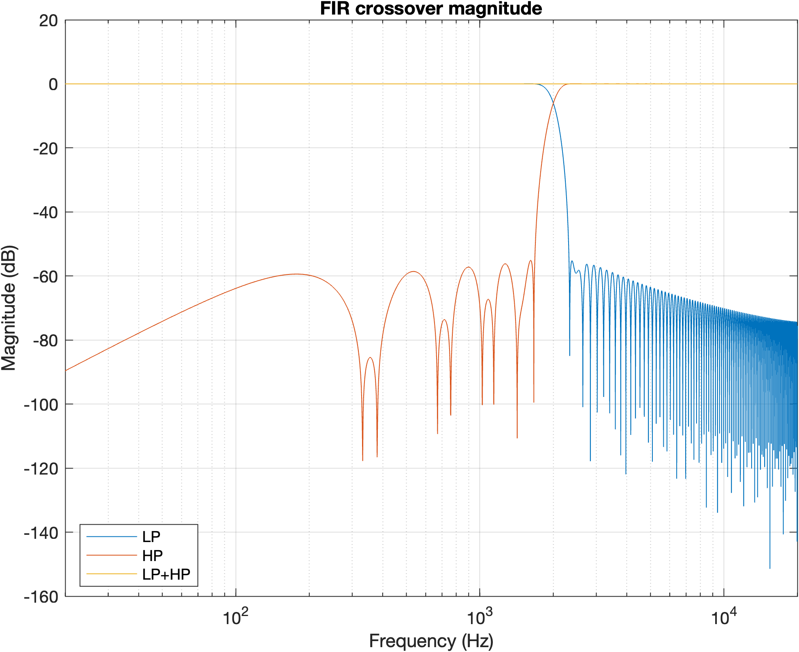
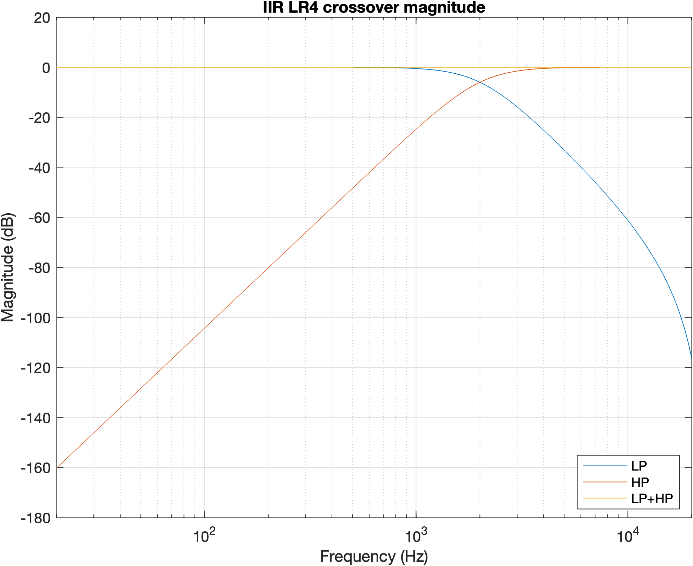
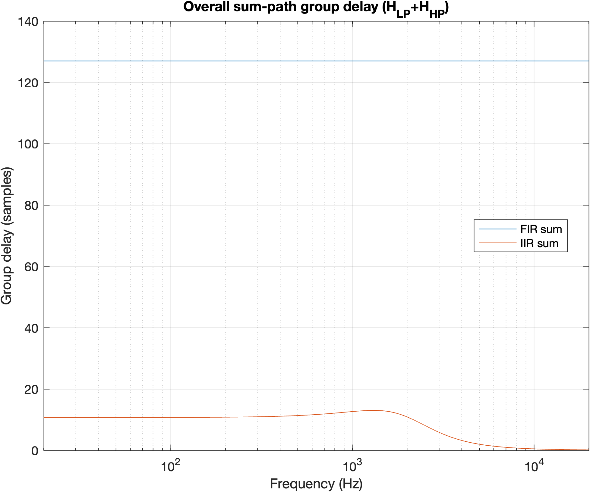

# Digital Audio Crossover — FIR vs IIR

**A MATLAB study of two-way digital audio crossovers:** complementary linear-phase FIR filtering versus a fourth-order Linkwitz–Riley (LR4) IIR design.

A crossover divides an audio signal into low- and high-frequency bands, as used in multi-driver loudspeaker systems. This project implements both approaches at the same crossover frequency, then examines **how they split, recombine, and change the timing of a signal**. It includes filter verification, WAV processing, time- and frequency-domain plots, optional per-band gain, and parameter-sweep metrics.

**[Run the project & explore the files](docs/USAGE.md)** · **[Written report](paper/paperCrossover_2456340.pdf)** · **[Presentation](paper/DSP_Crossover_Presentation.pdf)**

## The two designs

| | Linear-phase FIR | Linkwitz–Riley IIR |
|---|---|---|
| Construction | Windowed FIR low-pass with a spectrally complementary high-pass | Cascaded second-order Butterworth low-pass and high-pass sections (LR4) |
| Recombined signal, without EQ | An exact delayed copy in the ideal filter model: `H_LP + H_HP = z⁻ᴰ` | Approximately unity magnitude, with frequency-dependent phase (an all-pass-like sum response) |
| Timing | Constant group delay of `(N − 1)/2` samples | Frequency-dependent group delay |
| Main trade-off | Linear phase and a fixed delay, with longer filters | Compact recursive filtering, without linear-phase reconstruction |

The default configuration uses **48 kHz** sampling, a **2 kHz** crossover, and a **255-tap FIR** (127 samples, approximately **2.65 ms** of delay). The LR4 implementation uses fourth-order low- and high-pass branches.

## Frequency response & reconstruction

The plots below are generated from the project's MATLAB code. Each shows the low-pass, high-pass, and summed transfer functions, making the crossover behavior visible without opening the report.

| FIR — complementary filters | IIR — LR4 filters |
|:---:|:---:|
|  |  |

**The crucial distinction is in the sum, not just the individual bands.** For the FIR design, spectral complementarity gives a pure delay when the two branches are summed without EQ. For the IIR design, a nearly flat summed *magnitude* does not imply an unchanged waveform: the phase response matters.

### The timing trade-off

The FIR summed path has constant delay; the IIR summed path has a frequency-dependent delay. The time-domain analysis compares FIR reconstruction to the input and IIR reconstruction to its *equivalent sum-path filtered reference*, not just a shifted input. See the [reconstruction-error plot](figures/Fig07_err_noEQ.png) for the detailed comparison.

## Audio processing & per-band EQ

Both designs split an input WAV file into **low**, **high**, and **summed** outputs. Optional independent gain on each band illustrates how a crossover can be paired with simple driver-level balancing. The default EQ example applies **+5 dB** to the low band and **−3 dB** to the high band.

The [FIR](figures/Fig12_FIR_spectra_EQ_bass_pulse.png) and [IIR](figures/Fig13_IIR_spectra_EQ_bass_pulse.png) EQ spectrum plots compare the input with the summed and individual band outputs. **With EQ enabled, the two branches are deliberately reweighted; the no-EQ reconstruction properties should not be assumed to hold unchanged.**

## Explore or reproduce

- **[Getting started & repository guide](docs/USAGE.md)** — MATLAB requirements, commands, configuration, file map, outputs, and experiments.
- **[Written report (PDF)](paper/paperCrossover_2456340.pdf)** — project background and analysis.
- **[Presentation (PDF)](paper/DSP_Crossover_Presentation.pdf)** — condensed overview.
- **[All figures](figures)** — additional magnitude, delay, time-domain, and spectral plots.

The report and presentation originate from an earlier iteration of the project; details of file organization or execution may differ from the current MATLAB implementation. **The code is the reference for reproducing the current pipeline.**

*Scope:* This is an offline MATLAB comparison and audio-processing study, not a real-time loudspeaker DSP deployment or a validated acoustic measurement of physical drivers.

[MIT License](LICENSE).
